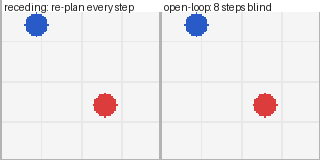
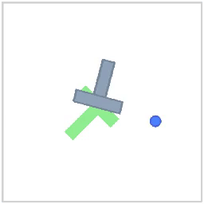

# evla-lab

**An end-to-end Vision-Language-Action pipeline: fine-tune a 450M VLA, optimize its inference, deploy it through a safety-checked runtime, and measure success rates you can defend.**

[](https://github.com/mystic-qaq/evla-lab/actions/workflows/ci.yml)




*Same policy, same scene, two execution strategies. Against a **moving** target,
re-planning every step wins (77% vs 40% success) because an 8-step plan goes stale.
Against the **static** Push-T task the ranking flips (finding 3 below): there is no
motion to track, and re-planning only re-samples noise. Execution strategy is a
measured choice, not a default — which is the point of this repository.*

---

## Why this exists

Most VLA repositories stop at "here is a checkpoint and a training script". A robot
competition is decided by the *other* four questions:

| stage | question | where it is answered here |
|---|---|---|
| 1. fine-tune | does adapting a public VLA to my task actually help? | `evla finetune`, SmolVLA-450M on Push-T |
| 2. inference | how fast is one decision, and what does speed cost in accuracy? | `evla optimize`, Pareto study |
| 3. deployment | what happens when inference is late, or the policy outputs nonsense? | `evla deploy`, runtime + safety + HAL |
| 4. evaluation | is "3 points better" a real difference or noise? | `evla eval`, Wilson CI + paired McNemar |

Every stage writes a JSON artefact, so a claim is a file, not a memory of a terminal.

## 2026-11-18 Push-T retraining

After fixing episode peak tracking and the valid-action training loss, seven training
branches were completed on Server3090. The selected SmolVLA checkpoint scored
**65/200, 32.5%** on held-out seeds 30000–30199, with a 95% Wilson interval of
**26.4–39.3%**. The original checkpoint scored **16/200, 8.0%** on the same seeds.
The measured point estimate is 17.5 percentage points below this run's 50% reference target.

The selected model mixes 206 human demonstrations with 626 new successful simulated
demonstrations, using a fourfold sampling weight for the human data. It predicts 16
actions and executes 8, with bf16, compilation and four flow steps.

```bash
CUDA_VISIBLE_DEVICES=3 HF_HUB_OFFLINE=1 evla eval -c configs/eval_pusht_best.yaml
```

The gain decomposes multiplicatively. All four arms were re-run on the same 200 held-out
seeds, so every row is a paired comparison (`results/pusht_retrain_20261118/ablation/`):

| step | success | factor | paired McNemar |
|---|---:|---:|---|
| original checkpoint, 50-action chunks, execute 20 | 8.0% | — | — |
| corrected loss + 16-step prediction, execute 8, human data only | 20.0% | **2.50x** | p = 7.2e-4 |
| + 626 successful teacher rollouts | 29.5% | 1.48x | p = 0.040 |
| + 4x human mixing (the selected checkpoint) | 32.5% | 1.10x | p = 0.58 |

2.50 x 1.48 x 1.10 = 4.06. The largest single term is the training fix, not the data, and
teacher-only training already reaches 29.5%. The mixing term is **not resolved** at 200
episodes -- 64 validation seeds made it look like 15 points, the held-out seeds say 3.
Keeping the test range frozen is what caught that.

Weights are available in `outputs/pusht_retrain_20261118/best/pretrained_model` in the local
workspace and on Server3090. Full results and reproduction details are in the training report.
[Training report](results/pusht_retrain_20261118/TRAINING_REPORT.md)

## Historical Push-T results

SmolVLA-450M fine-tuned on Push-T for 20k steps (single RTX 3090, 4.3 h), evaluated on
40 paired seeds — 20 for the receding configuration, which needs 300 inferences per
episode. A reset bug inflated the peak coverage logged by these runs. The table keeps
the recorded success and latency measurements. See the corrected coverage below.

| config | exec / chunk | success (95% CI) | control Hz | p50 infer |
|---|---|---|---:|---:|
| zero-shot checkpoint | 50 / 50 | 0% (0–9%) | 137 | 237 ms |
| fine-tuned, fp32 | 50 / 50 | 5% (1–17%) | 130 | 250 ms |
| fine-tuned, bf16 | 50 / 50 | 2% (0–13%) | 127 | 261 ms |
| + `torch.compile` | 50 / 50 | 8% (3–20%) | **229** | **86 ms** |
| + compile + 4 flow steps | 50 / 50 | 10% (4–23%) | **270** | **54 ms** |
| + compile + 4 steps, exec 20 | 20 / 50 | 10% (4–23%) | 185 | 55 ms |
| receding horizon (exec 1) | 1 / 50 | 0% (0–16%) | 18 | 52 ms |
| temporal ensemble (exec 10) | 10 / 50 | 5% (1–17%) | 18 | 52 ms |



*A fine-tuned rollout from the fixed seed list.*

Full artefacts: [`results/pusht_sweep/REPORT.md`](results/pusht_sweep/REPORT.md),
[`LEADERBOARD.md`](results/pusht_sweep/LEADERBOARD.md) (paired McNemar),
[`results/pusht_learning_curve/`](results/pusht_learning_curve),
[`results/pusht_lora/`](results/pusht_lora).

**Corrected evaluation.** On the original 40 seeds, the 20k checkpoint achieved
4/40 with both execution lengths. Its corrected mean episode peak coverage is 0.647
with 20 steps per plan and 0.492 with 50. At 20 steps per plan, 16 of the 36 failures
reached 0.85. The corrected 12k, 16k, 20k, and 25k checkpoint means on the learning curve
protocol are 0.507, 0.390, 0.436, and 0.460.

**Inference latency.** At bf16 batch 1, median inference time fell from 261 ms to 86 ms
with compilation and to 54 ms with four flow steps.

## The data: where it comes from, and what it can teach

`lerobot/pusht` is not ours. It is the Push-T demonstration set released with Diffusion
Policy (Chi et al., arXiv 2303.04137, MIT licence), repackaged in the LeRobot format.
The original zarr archive is still at diffusion-policy.cs.columbia.edu; the Hub copy
changes the container (parquet + AV1 video), renames the keys to
`observation.state` / `observation.image` / `action`, and adds one task string. The
demonstrations are human teleoperation; the paper documents a 3Dconnexion SpaceMouse for
its real-robot stations and does not state the device for the simulator set.

`python scripts/audit_dataset.py --root data/pusht` prints all of this from the copy on
disk. Three properties matter more than the size:

- **Episodes are 49-246 frames (median 122), not 300.** That is 5-25 s of human control,
  ending when the operator decided the block was in place. A 300-step evaluation asks the
  policy to stay stable for 2.5x longer than the median demonstration.
- **The action is an absolute end-effector target, not a delta**, and the state is a
  position with no velocity. Velocity has to be inferred from context -- which is why the
  toy environment in this repo carries target velocity explicitly, and why a policy here
  reacts late to a block that is already rolling.
- **The converted dataset records zero successful episodes.** Under the current
  environment's reward conversion, recorded peak coverage runs 0.77–0.90, with a
  median of 0.85. These values describe the converted labels. Demonstration replay
  is needed to check geometric success under the evaluation environment.

## Push-T training fixes

Push-T measures coverage as the intersection area divided by the target area and
terminates when it exceeds 0.95. The adapter resets the peak on every episode and logs
the position and angle errors at that peak. The archived JSONs above predate this fix.

`evla finetune` uses the LeRobot 0.4.4 training loop with a corrected SmolVLA loss.
It reads `action_is_pad`, slices the loss to the physical action dimensions and divides
by the number of valid elements. The independent train, validation and test seed
ranges keep simulator demonstration collection out of checkpoint selection and testing.

## Deployment run: simulator, 10 Hz, safety layer on

```bash
evla deploy -c configs/deploy.yaml      # fixed-rate loop + policy server + HAL + safety
```

```
steps                 900        (3 episodes x 300, at a real 10 Hz)
inference calls        45        (one per 20 executed actions)
deadline misses         0        (mean budget use 3.1%, worst step 76 ms of 100 ms)
safety                 12 / 900 actions rate-limited, 0 e-stop events
wall time            89.8 s      (== 900 steps / 10 Hz, exactly as scheduled)
```

That is the difference between "the model runs" and "the loop holds its rate": the
budget is spent on inference *amortised over chunks*, and when a policy output jumps
more than 80 px the safety layer rate-limits it instead of letting the arm do it.
Raw report: [`results/deploy_sim.json`](results/deploy_sim.json).

## Quickstart — no GPU, no robot, ~1 minute

```bash
git clone https://github.com/mystic-qaq/evla-lab && cd evla-lab
pip install -e ".[dev]" torch --extra-index-url https://download.pytorch.org/whl/cpu

evla doctor          # what is installed, is CUDA visible
evla quickstart      # collect -> train -> evaluate -> report, all on CPU
```

`evla quickstart` runs the *entire* pipeline on a dependency-free toy task and
writes `outputs/quickstart/eval/REPORT.md`. It is also what CI runs, which is why
the pipeline cannot silently rot.

```bash
evla toy-eval --policy outputs/quickstart/toy_flow.npz --episodes 30 --drift 0.03
```

```
receding-1       76.7% [59.1%, 88.2%] (23/30)   582.4 Hz
open_loop-8      40.0% [24.6%, 57.7%] (12/30)   802.7 Hz
temporal_ens-8   60.0% [42.3%, 75.4%] (18/30)   575.0 Hz
```

Same weights, same 30 scenes, three execution strategies: **open-loop execution is
38% faster and 37 points worse** once the target moves. Temporal ensembling recovers
most of the accuracy at the same control rate as re-planning. That is the whole
argument for measuring a trade-off instead of optimizing one number.

## Reproducing the VLA study

Requires one 24 GB GPU. Wall-clock on an RTX 3090: 4.3 h fine-tune, ~10 min learning
curve, ~35 min optimisation matrix, ~2 min deployment run.

```bash
bash scripts/setup_env.sh                    # torch + lerobot + evla in .venv
bash scripts/download_assets.sh              # SmolVLA-base (873 MB) + Push-T dataset
evla finetune -c configs/finetune_smolvla_pusht.yaml
evla sweep    -c configs/sweep_learning_curve.yaml   # 6 checkpoints, 20 seeds each
evla sweep    -c configs/sweep_pusht.yaml            # 8 configs, 40 seeds each
evla deploy   -c configs/deploy.yaml                 # fixed-rate loop, 10 Hz
```

`evla sweep` produces `results/pusht_sweep/{REPORT.md, LEADERBOARD.md, *.json, *.png}`.

## One policy, four interfaces

```
                    Observation (state + images + task)
                                   │
        ┌──────────────────────────▼──────────────────────────┐
        │                      Policy                         │
        │        predict_chunk(obs) -> (H, action_dim)        │
        └───┬───────────────┬──────────────────┬──────────────┘
            │               │                  │
     ┌──────▼─────┐  ┌──────▼──────┐   ┌───────▼────────┐
     │ChunkExecutor│  │ Instrumented│   │  RemotePolicy  │
     │ receding /  │  │  (latency)  │   │  (TCP server)  │
     │ open-loop / │  └─────────────┘   └───────┬────────┘
     │ temporal-ens│                            │
     └──────┬──────┘                     ┌──────▼───────┐
            │                            │ PolicyServer │
     ┌──────▼──────┐                     └──────────────┘
     │ SafetyLayer │  clamp · rate-limit · watchdog · e-stop
     └──────┬──────┘
     ┌──────▼──────┐
     │  HAL        │  Pymunk sim  ·  SO-101 arm
     └─────────────┘
```

Because everything speaks `Observation`/`Policy`, a 450M SmolVLA, a 2M flow-matching
MLP and a scripted controller are interchangeable — including inside unit tests.

## Repository layout

```
src/evla/
  types.py            Observation, StepResult, Policy            (the whole interface)
  envs/               toy_reach (numpy, no deps) · pusht (Pymunk)
  models/             smolvla adapter (450M) · flow_chunk (from scratch, 2M)
  data/               demo collection, chunk construction, normalisation
  control/            ChunkExecutor: receding / open_loop / temporal_ens
  optimize/           latency profiler · capability-probing optimization pipeline
  deploy/             runtime · policy server/client · HAL (sim, SO-101) · safety
  eval/               rollout runner · statistics · report · paired leaderboard
  cli.py              evla doctor/quickstart/finetune/bench/eval/sweep/serve/deploy
configs/              every experiment is a YAML file, not a shell history
docs/                 architecture · optimization study · deployment · eval protocol · playbook
results/              committed experiment artefacts (JSON + figures + reports)
tests/                39 tests, CPU only, ~40 s
```

## Design decisions in one line each

- **Wrap LeRobot's trainer, own the rest.** Re-implementing SmolVLA fine-tuning
  would be a copy with new bugs; inference cost, deployment and measurement are
  where the value is. `evla finetune` prints the exact upstream command it runs.
- **Policies return chunks, not actions.** Execution strategy becomes an explicit,
  measurable choice instead of a hidden queue inside the model wrapper.
- **Latency is measured with `cuda.synchronize()` inside the control loop**, because
  an async timer under-reports inference by 3-10x and p95 — not the mean — decides
  whether the robot stalls.
- **Clipping is counted, not fatal.** A badly calibrated policy is a calibration
  problem; the e-stop is reserved for non-finite actions.
- **No bare percentages.** Every success rate ships with a Wilson interval and an
  episode count; comparisons use identical seeds and McNemar's exact test.

More: [`docs/ARCHITECTURE.md`](docs/ARCHITECTURE.md),
[`docs/OPTIMIZATION.md`](docs/OPTIMIZATION.md),
[`docs/DEPLOYMENT.md`](docs/DEPLOYMENT.md),
[`docs/EVAL_PROTOCOL.md`](docs/EVAL_PROTOCOL.md),
[`docs/COMPETITION_PLAYBOOK.md`](docs/COMPETITION_PLAYBOOK.md).

## What this does *not* claim

- **No real robot was used.** Every number is simulated. The HAL, runtime, safety
  layer and SO-101 backend are written and sim-validated; hardware validation is the
  first item of the roadmap.
- **Push-T is a small benchmark.** It is the right size for studying inference cost
  and execution strategy in 12 hours; it is not evidence of manipulation skill.
- **The absolute success rate is not the point.** The pipeline, the failure
  instrumentation and the measurement protocol are.

## Roadmap

1. SO-101 hardware bring-up: calibration, action-scaling, 2 Hz dry runs, failure taxonomy.
2. Data scaling study: success rate vs number of demonstrations (the most persuasive
   plot in imitation learning).
3. int8 quantization of the VLM backbone with an accuracy check (needs calibration data).
4. Multi-task suite with per-task CIs instead of one aggregate number.

## References

- SmolVLA (Shukor et al., 2025) — the 450M VLA this repo fine-tunes.
- ACT / temporal ensembling (Zhao et al., 2023) — the chunk-averaging baseline.
- Flow Matching (Lipman et al., 2023), π0 (Black et al., 2024) — action-expert formulation.
- Diffusion Policy (Chi et al., 2023) — action chunking as a variance-reduction device.
- LeRobot — dataset, training and hardware SDK.

MIT licensed.
