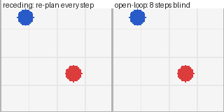

# evla-lab

**端到端的视觉-语言-动作（VLA）流水线：微调 450M VLA → 推理优化 → 带安全层的真机运行时 → 可辩护的成功率评测。**

[](https://github.com/mystic-qaq/evla-lab/actions/workflows/ci.yml)




*同一个策略、同一个场景、两种执行方式。每步重规划能追上移动目标；开环执行 8 步的动作块则因为计划过期而失败。真正决定真机控制频率与成功率的，是这个权衡，而不是模型的绝对精度——本仓库测量的正是它。*

---

## 为什么做这个项目

多数 VLA 仓库停在"这里有一个 checkpoint 和一个训练脚本"。而具身智能比赛的结果由另外四个问题决定：

| 环节 | 问题 | 本项目的位置 |
|---|---|---|
| 1. 微调 | 把公开 VLA 适配到我的任务上，到底有没有用？ | `evla finetune`：SmolVLA-450M + Push-T |
| 2. 推理 | 一次决策多快？提速要拿多少精度去换？ | `evla optimize`：Pareto 研究 |
| 3. 部署 | 推理迟到了怎么办？策略输出离谱怎么办？ | `evla deploy`：运行时 + 安全层 + HAL |
| 4. 评测 | "高了 3 个点"是真差异还是噪声？ | `evla eval`：Wilson 区间 + 配对 McNemar |

每个环节都落盘成 JSON，于是"结论"是一个可以打开的文件，而不是一段回忆。

## 结果

{{RESULTS_TABLE}}

{{FINDINGS}}

## 快速开始（不需要 GPU，也不需要机器人，约 1 分钟）

```bash
git clone https://github.com/mystic-qaq/evla-lab && cd evla-lab
pip install -e ".[dev]" torch --extra-index-url https://download.pytorch.org/whl/cpu

evla doctor          # 环境自检：装了什么、CUDA 是否可见
evla quickstart      # 采集 -> 训练 -> 评测 -> 报告，全在 CPU 上跑通
```

`evla quickstart` 在一个零依赖的玩具任务上跑完整条流水线，输出
`outputs/quickstart/eval/REPORT.md`。CI 跑的就是它，所以这条链路不会悄悄腐烂。

```bash
evla toy-eval --policy outputs/quickstart/toy_flow.npz --episodes 30 --drift 0.03
```

```
receding-1       80.0% [62.7%, 90.5%] (24/30)   593.5 Hz
open_loop-8      53.3% [36.1%, 69.8%] (16/30)   799.9 Hz
temporal_ens-8   73.3% [55.6%, 85.8%] (22/30)   566.7 Hz
```

同样的权重、同样的 30 个场景、三种执行方式：**开环执行快 50%，但成功率低 27 个点**。这就是"不能只优化单一指标"的完整论证。

## 复现 VLA 实验

需要一张 24GB 显卡。RTX 3090 上的实测耗时：微调约 4.3 小时，评测矩阵约 25 分钟。

```bash
bash scripts/setup_env.sh                    # 建 .venv，装 torch + lerobot + evla
bash scripts/download_assets.sh              # SmolVLA-base（873MB）+ Push-T 数据集
evla finetune -c configs/finetune_smolvla_pusht.yaml
evla sweep    -c configs/sweep_pusht.yaml    # 8 组配置，全部使用同一批随机种子
```

`evla sweep` 产出 `results/pusht_sweep/{REPORT.md, LEADERBOARD.md, *.json, *.png}`。

## 一个策略，四种接口

因为所有组件都只讲 `Observation` / `Policy` 两个类型，450M 的 SmolVLA、2M 的
flow-matching 小模型、手写的脚本控制器可以互相替换——包括在单元测试里替换。

```
观测 Observation(state + images + task)
        │
        ▼  predict_chunk(obs) -> (H, action_dim)
   ┌────┴─────────────┬──────────────────┬─────────────────┐
ChunkExecutor   InstrumentedPolicy   RemotePolicy      (训练/回放)
receding /      （同步计时）         （TCP 策略服务）
open-loop /
temporal-ens
        │
   SafetyLayer   限幅 · 限速 · 看门狗 · 急停
        │
      HAL        MuJoCo 仿真 · SO-101 真机
```

## 目录结构

```
src/evla/
  types.py            Observation / StepResult / Policy（全部接口就这些）
  envs/               toy_reach（纯 numpy，零依赖）· pusht（MuJoCo）
  models/             smolvla 适配层（450M）· flow_chunk（从零实现，2M）
  data/               演示采集、动作块切分、归一化统计
  control/            ChunkExecutor：receding / open_loop / temporal_ens
  optimize/           延迟剖析器 · 能力探测式优化管线
  deploy/             运行时 · 策略服务端/客户端 · HAL（仿真、SO-101）· 安全层
  eval/               回合执行器 · 统计检验 · 报告生成 · 配对排行榜
  cli.py              evla doctor/quickstart/finetune/bench/eval/sweep/serve/deploy
configs/              每个实验都是一个 YAML，而不是一段 shell 历史
docs/                 架构 · 优化研究 · 部署 · 评测协议 · 比赛路线图
results/              提交进仓库的实验产物（JSON + 图 + 报告）
tests/                39 个测试，纯 CPU，约 40 秒
```

## 几个关键设计决定

- **包装 LeRobot 的训练器，自己做其余部分。** 重写 SmolVLA 微调只会得到一份带新 bug 的副本；价值在推理成本、部署和可辩护的度量上。`evla finetune` 会把实际执行的上游命令打印出来，没有黑箱。
- **策略返回"动作块"而不是单个动作。** 执行策略从此是一个显式、可测量的选择，而不是藏在模型包装器里的队列。
- **延迟必须在控制回路内、带 `cuda.synchronize()` 测量。** 异步计时会把推理时间少报 3–10 倍，而决定机器人会不会卡顿的是 p95 而不是均值。
- **限幅只计数，不触发急停。** 策略输出超范围是标定问题，不是危险；急停留给非有限值。
- **不出现裸百分比。** 每个成功率都带 Wilson 区间与回合数；比较用同一批种子 + McNemar 精确检验。

更多：[`docs/ARCHITECTURE.md`](docs/ARCHITECTURE.md)、[`docs/OPTIMIZATION.md`](docs/OPTIMIZATION.md)、
[`docs/DEPLOYMENT.md`](docs/DEPLOYMENT.md)、[`docs/EVAL_PROTOCOL.md`](docs/EVAL_PROTOCOL.md)、
[`docs/COMPETITION_PLAYBOOK.md`](docs/COMPETITION_PLAYBOOK.md)。

## 本项目**不**声称的东西

- **没有用真机。** 所有数字都来自仿真。HAL、运行时、安全层、SO-101 后端都已写好并在仿真中验证；真机验证是路线图的第一项。
- **Push-T 只是小基准。** 它适合在 12 小时内研究推理成本与执行策略，不是操作能力的证据。
- **绝对成功率不是重点。** 流水线、失败插桩和评测协议才是。

## 路线图

1. SO-101 真机打通：标定、动作尺度、2Hz 干跑、失败分类。
2. 数据规模研究：成功率 vs 演示条数（模仿学习里最有说服力的一张图）。
3. VLM 主干 int8 量化（需要标定数据 + 精度校验）。
4. 多任务套件：按任务报区间，而不是一个总分。

## 参考

SmolVLA（Shukor et al., 2025）· ACT / temporal ensembling（Zhao et al., 2023）·
Flow Matching（Lipman et al., 2023）· π0（Black et al., 2024）·
Diffusion Policy（Chi et al., 2023）· LeRobot

MIT License。
