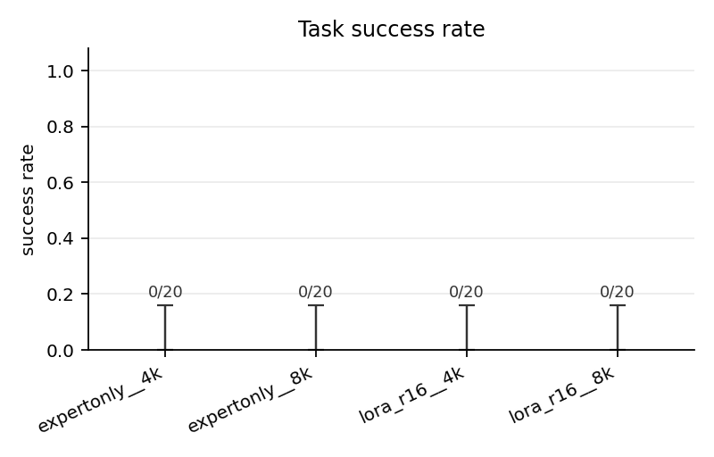
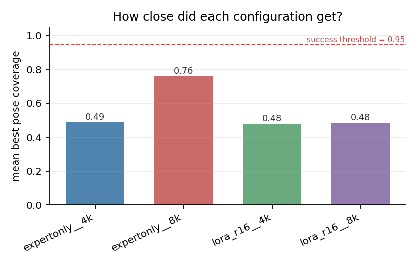
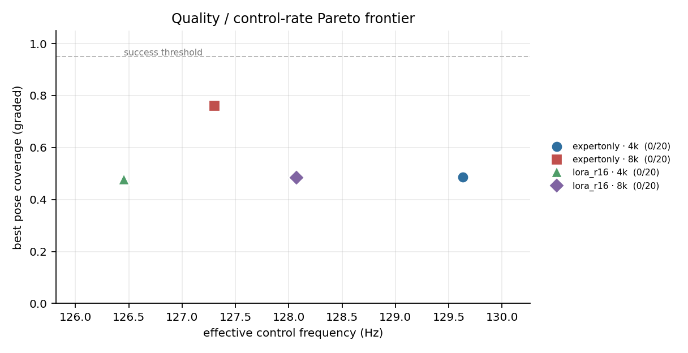
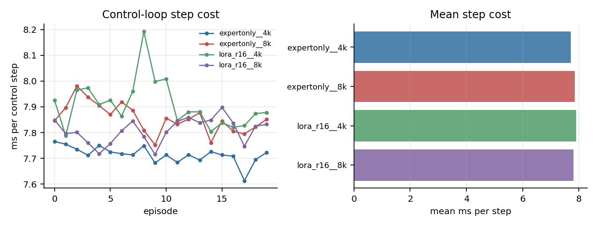
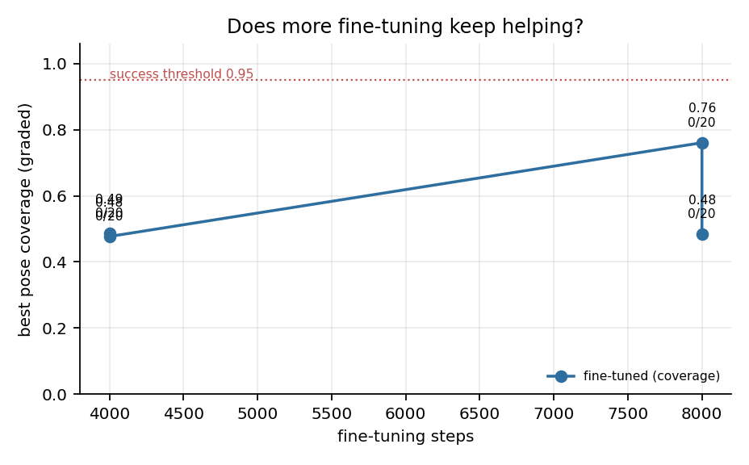

# Evaluation report

| # | config | mode (exec/chunk) | success | 95% Wilson CI | control Hz | p50 lat (ms) | p95 lat (ms) | steps/inference | mean steps | best coverage |
|---|--------|-------------------|---------|---------------|------------|--------------|--------------|-----------------|------------|-----------------|
| 1 | expertonly__4k | open_loop (50/50) | **0%** | 0%-16% | 129.6 | 256.07 | 262.94 | 50.0 | 300 | 0.49 |
| 2 | expertonly__8k | open_loop (50/50) | **0%** | 0%-16% | 127.3 | 261.33 | 267.56 | 50.0 | 300 | 0.76 |
| 3 | lora_r16__4k | open_loop (50/50) | **0%** | 0%-16% | 126.5 | 264.26 | 277.1 | 50.0 | 300 | 0.48 |
| 4 | lora_r16__8k | open_loop (50/50) | **0%** | 0%-16% | 128.1 | 260.64 | 263.92 | 50.0 | 300 | 0.48 |

`control Hz` is the effective closed-loop rate (1 / mean environment step time, including reused actions); `p50/p95 lat` are per-inference latencies measured with CUDA synchronisation; `steps/inference` is how many control steps one forward pass buys. `best coverage` is the mean best pose overlap reached during an episode (success needs 0.95) -- a graded signal that keeps moving when binary success is still stuck at zero.

## Figures

### success

### coverage

### pareto

### latency

### learning_curve

## Failure taxonomy

| config | episodes | success | near miss | touched, missed | never contacted | unknown |
|---|---:|---:|---:|---:|---:|---:|
| expertonly__4k | 20 | 0 (0%) | 0 | 20 | 0 | 0 |
| expertonly__8k | 20 | 0 (0%) | 0 | 20 | 0 | 0 |
| lora_r16__4k | 20 | 0 (0%) | 0 | 20 | 0 | 0 |
| lora_r16__8k | 20 | 0 (0%) | 0 | 20 | 0 | 0 |

*Near miss* = the block was moved and the best pose overlap reached 0.85 of the 0.95 needed for success (position roughly right, pose not). *Never contacted* = the end-effector never touched the block, which points at reaching/perception rather than manipulation.

## Raw

Per-episode records and full configuration are in the sibling JSON files.
