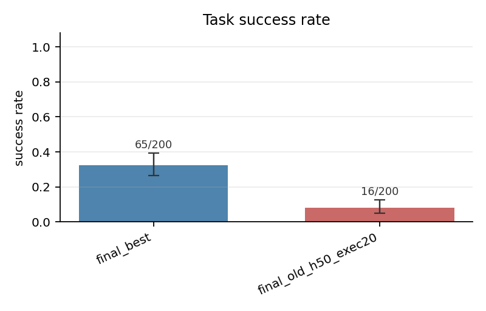
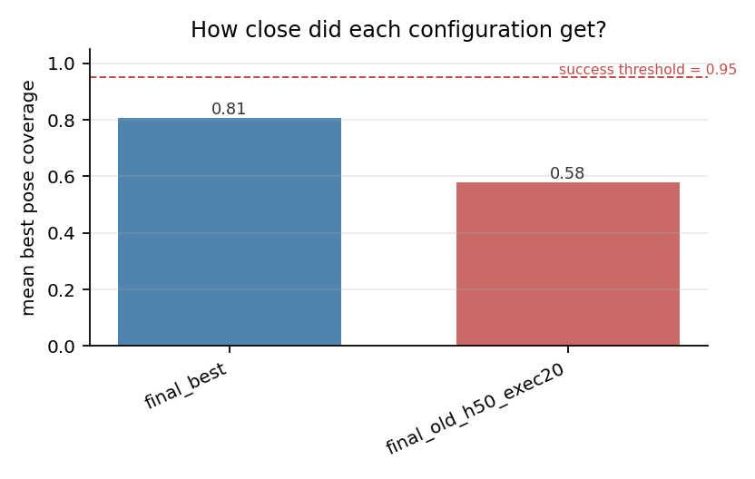
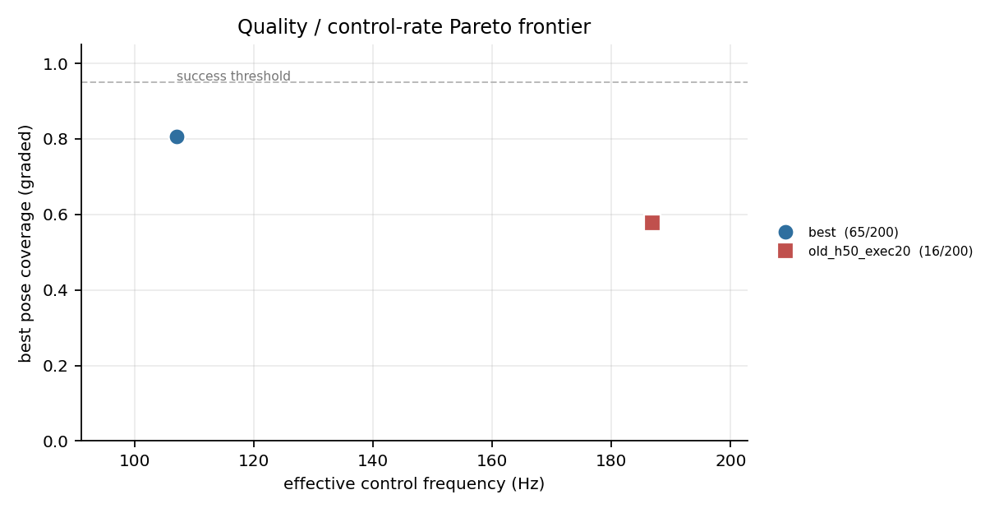
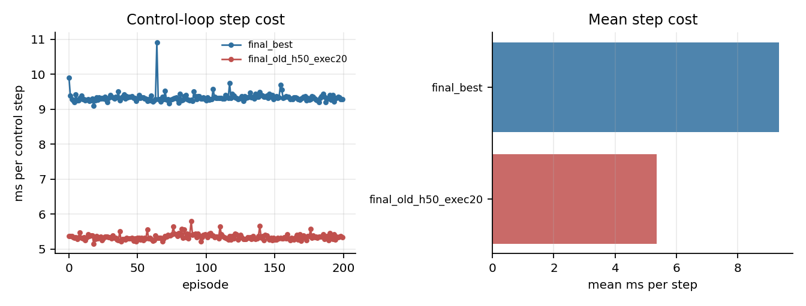

# Push-T held-out retraining evaluation

| # | config | mode (exec/chunk) | success | 95% Wilson CI | control Hz | p50 lat (ms) | p95 lat (ms) | steps/inference | mean steps | best coverage |
|---|--------|-------------------|---------|---------------|------------|--------------|--------------|-----------------|------------|-----------------|
| 1 | final_best | open_loop (8/16) | **32%** | 26%-39% | 107.0 | 51.96 | 53.61 | 7.888 | 266 | 0.81 |
| 2 | final_old_h50_exec20 | open_loop (20/50) | **8%** | 5%-13% | 186.9 | 53.2 | 55.23 | 19.948 | 289 | 0.58 |

`control Hz` is offline simulation throughput computed from mean environment step time. `p50/p95 lat` measure individual inference calls with CUDA synchronisation. `steps/inference` counts the environment steps served by one prediction. `best coverage` averages the maximum coverage of each episode.

## Figures

### success

### coverage

### pareto

### latency

## Failure taxonomy

| config | episodes | success | near miss | touched, missed | never contacted | unknown |
|---|---:|---:|---:|---:|---:|---:|
| final_best | 200 | 65 (32%) | 72 | 63 | 0 | 0 |
| final_old_h50_exec20 | 200 | 16 (8%) | 60 | 124 | 0 | 0 |

*Near miss* means a failed episode with recorded contact and peak coverage of at least 0.85. *Never contacted* means the environment recorded zero contacts during the episode.

## Raw

Per-episode records and full configuration are in the sibling JSON files.
