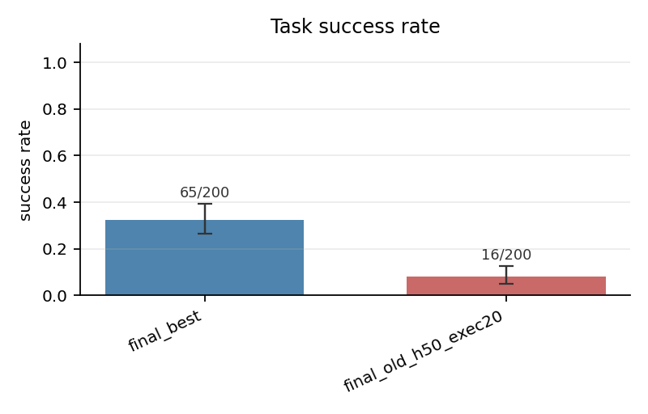

# Push-T 修复与重训报告

最终预留200回合测得 **65/200，32.5%**，原模型为 **16/200，8.0%**。提升为 **24.5个百分点**，成功率比值为 **4.06**。本轮采用50%的参考目标，实测值与该目标相差17.5个百分点。

## 最终测试

每回合上限300步，成功条件采用 gym-pusht 的 `coverage > 0.95`。覆盖率定义为方块与目标的交集面积除以目标面积。最终测试种子为30000–30199。权重和推理运行点通过10100–10163共64个验证种子冻结。

| 模型 | 成功数 | 成功率 | 95% Wilson区间 | 平均回合峰值覆盖率 |
|---|---:|---:|---|---:|
| 原20k模型 | 16/200 | 8.0% | 5.0%–12.6% | 0.5776 |
| 本轮最佳模型 | 65/200 | 32.5% | 26.4%–39.3% | 0.8058 |

配对比较中，两者都成功11回合，原模型单独成功5回合，新模型单独成功54回合。McNemar双侧精确检验的 `p = 1.91e-11`。



最佳运行点采用bf16、torch.compile、4步flow，预测16步后执行8步。单次推理p50为51.96毫秒，p95为53.61毫秒，最大值为515.35毫秒。JSON中的 `control_hz` 按离线仿真步数和墙钟时间计算。仿真物理控制周期为0.1秒。

逐回合结果与完整运行参数保存在原始记录中。[原模型记录](final_old.json) · [新模型记录](final_best.json) · [配对统计](provenance/comparison.json)

## 提升来自哪里（同一批留出种子的消融）

四条实验线全部在 30000–30199 这 200 个留出种子上重跑，同判据、同 300 步上限，各自使用验证集冻结的运行点。
详见 [`ablation/REPORT.md`](ablation/REPORT.md)。

| 实验线 | 成功 | 成功率 | 倍数 | 配对 McNemar |
|---|---:|---:|---:|---|
| 原 20k 权重（50 步块，执行 20） | 16/200 | 8.0% | — | — |
| 修 loss + 16 步块/执行 8，仅人类演示 | 40/200 | 20.0% | **2.50×** | p = 7.2e-4 |
| 加入 626 条成功演示（不用原演示） | 59/200 | 29.5% | 1.48× | p = 0.040 |
| 4× 人类 + 626 条成功演示（选中权重） | 65/200 | 32.5% | 1.10× | p = 0.58 |

2.50 × 1.48 × 1.10 = 4.06，与主线成功率比值一致。三点需要说明：

- **最大单项是修 bug，不是换数据。** 8% → 20% 这一步数据一条没改，只改了 loss 的归约和动作视界。
- **只用成功演示也能到 29.5%**，与最终模型的 32.5% 相差 3 个点。
- **混合的额外收益在本样本量下未分辨（p = 0.58）。** 验证集上混合 29/64 对教师 19/64 的 +15 点是 22 个候选取最大值的乐观偏差；
  留出集没有重现它。这一条推翻了本轮早期的口头结论，保留在此作为协议有效的证据。

## 完成的修复

- 在每次环境重置时重新初始化峰值覆盖率，同时记录峰值处的平移和角度误差。
- 将训练读取的动作掩码改为 `action_is_pad`。loss仅覆盖真实动作维度，并按有效时刻与动作维度的元素总数归一化。
- 让 `evla finetune` 默认通过项目适配器调用LeRobot训练循环，并记录训练种子、学习率和预测长度。
- 固定LeRobot 0.4.4及环境安装脚本中的gym-pusht 0.1.8，保留每个候选的配置和逐回合评测结果。

在原40个种子上复跑旧权重，成功数仍为4/40，平均峰值覆盖率修正为0.6470。40个回合的成功标志和终点覆盖率全部与原始记录匹配。[修正后的历史复跑](historical_check/corrected_old_seeds0_39.json)

## 数据和训练

原始集合包含206条人类演示、25,650帧。使用公开 `lerobot/diffusion_pusht` 权重，在1024个新仿真初始场景中采集626条成功演示、112,041帧。采集采用DDIM、16步去噪和16个并行环境，种子范围为40000–40255及41000–41767。采集器依据环境成功标志保存轨迹。[采集记录一](reference/diffusion_collection.json) · [采集记录二](reference/diffusion_collection_more.json)

最佳分支混合了206条原演示与626条新成功演示。原演示按4倍权重采样，合并后的集合有1450条采样轨迹、214,641帧，对应832条独立演示。各训练分支使用batch 32、随机种子1000，混合精度通过 `ACCELERATE_MIXED_PRECISION=bf16` 设置。

七个主训练分支累计完成56,000次新增更新，另有25步双帧模式冒烟训练。下表列出各分支已经测量的64回合候选中成功率最高的运行点。

| 分支 | 初始化 | 独立演示数 | 完成训练步数 | 候选checkpoint与flow步数 | 验证成功数 |
|---|---|---:|---:|---|---:|
| 原始演示 | 公开SmolVLA基础权重 | 206 | 12k | 12k / flow 4 | [19/64](validation/selection64/expanded_h16_012000_flow4_exec8.json) |
| 成功演示155 | 公开SmolVLA基础权重 | 155 | 12k | 12k / flow 10 | [16/64](validation/selection64/expanded_success_h16_012000_flow10_exec8.json) |
| 成功演示626 | 公开SmolVLA基础权重 | 626 | 12k | 12k / flow 10 | [19/64](validation/selection64/expanded_success_large_h16_012000_flow10_exec8.json) |
| 原20k续训 | 原20k权重 | 626 | 6k | 4k / flow 10 | [15/64](validation/selection64/expanded_warm_success_h16_004000_flow10_exec8.json) |
| 成功数据再续训 | 上一分支6k权重 | 626 | 4k | 4k / flow 10 | [17/64](validation/selection64/expanded_warm_refine_h16_004000_flow10_exec8.json) |
| 混合演示 | 原始演示分支12k权重 | 206+626 | 6k | 6k / flow 4 | [29/64](validation/selection64/expanded_mixed_h16_006000_flow4_exec8.json) |
| 双帧混合演示 | 混合演示分支2k权重 | 206+626 | 4k | 4k / flow 4 | [26/64](validation/selection64/expanded_context2_h16_004000_flow4_exec8.json) |

本轮选中了单帧混合演示分支6k权重。双帧分支使用当前观测与上一次规划时刻的观测，两者间隔8个环境步。适配器在训练和推理时构造相同的两帧输入，并在每个回合开始时清空历史。

此次提升来自loss、预测和执行长度、训练数据及初始化的联合改动。完整候选及冻结选择保存在记录中。[候选摘要](provenance/validation_summary.json) · [冻结选择](provenance/selection.json)

公开Diffusion Policy参考权重另在20000–20099的100回合中成功68次。该结果对应公开参考模型在本机环境的运行表现。[参考模型记录](reference/test_diffusion_reference.json) · [参考模型来源](https://huggingface.co/lerobot/diffusion_pusht)

## 剩余失败

最终135个失败回合中，72个回合曾达到0.85覆盖率，另有63个回合的峰值低于0.85。下一轮数据采集可以从这些失败状态出发，加入恢复轨迹与目标附近的修正动作。

## 使用与复现

本地推理权重位于 `outputs/pusht_retrain_20261118/best/pretrained_model`，Server3090上的对应目录位于 `/home/xy/Embodied_AI_Try/outputs/pusht_retrain_20261118/best/pretrained_model`。

在Server3090项目目录执行下面的命令。

```bash
CUDA_VISIBLE_DEVICES=3 HF_HUB_OFFLINE=1 .venv/bin/evla eval \
  -c configs/eval_pusht_best.yaml --out outputs/pusht_recheck.json
```

最佳模型先使用原始演示训练12k步，再在混合集合上训练6k步。相应配置保留了本轮输出目录。再次训练时，在配置副本中指定新的 `train.output_dir`，并将后续 `base_checkpoint` 指向对应的新checkpoint。[第一阶段配置](../../configs/finetune_smolvla_pusht_retrain.yaml) · [混合阶段配置](../../configs/finetune_smolvla_pusht_mixed.yaml) · [推理配置](../../configs/eval_pusht_best.yaml)

数据采集与混合准备使用项目脚本。混合脚本采用临时目录构建、完整性验证和原子发布，并验证已有集合后支持重试。[采集脚本](../../scripts/pusht_diffusion_reference.py) · [混合脚本](../../scripts/prepare_pusht_mixture.py)

45项测试通过。混合集合从原始来源重新构建后，通过了1450条轨迹、214,641帧及首尾视频帧的重新加载验证。双帧边界验证覆盖了人类演示重复边界及成功演示边界。交付权重的本地SHA-256与服务器一致。

`model.safetensors` 的SHA-256为 `f6c2834764b1cc4236316c6dc34e45fb05673e48b12374edb57c39253acd3495`。

运行环境为Python 3.10.21、PyTorch 2.10.0、LeRobot 0.4.4、gym-pusht 0.1.8、Pymunk 6.11.1。完整版本和源码校验值保存在环境记录中。[环境记录](provenance/environment.json) · [测试协议](provenance/final_protocol.json)

视频包含固定首个测试种子30000的失败回合，以及最终测试中的首个成功种子。视频按2倍仿真速度播放。[固定首回合](final_seed30000.mp4) · [成功示例](successful_example.mp4)
