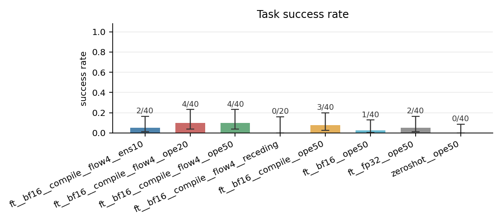
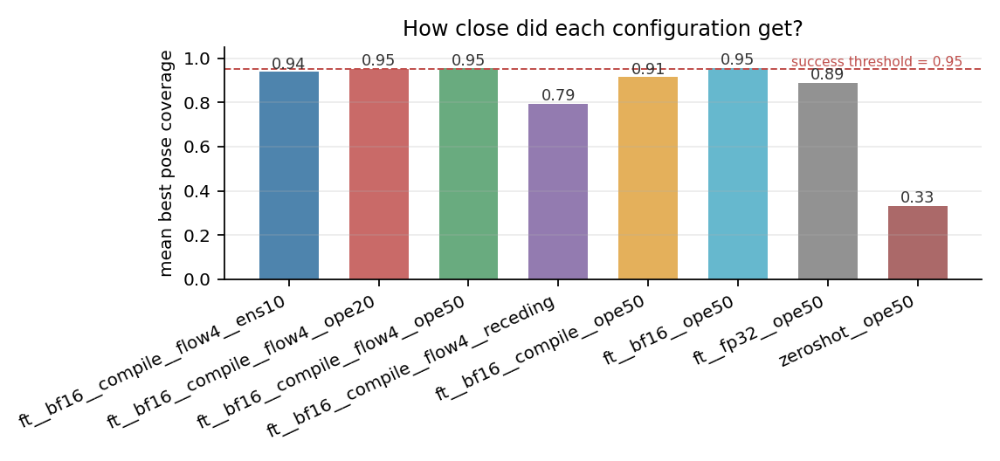
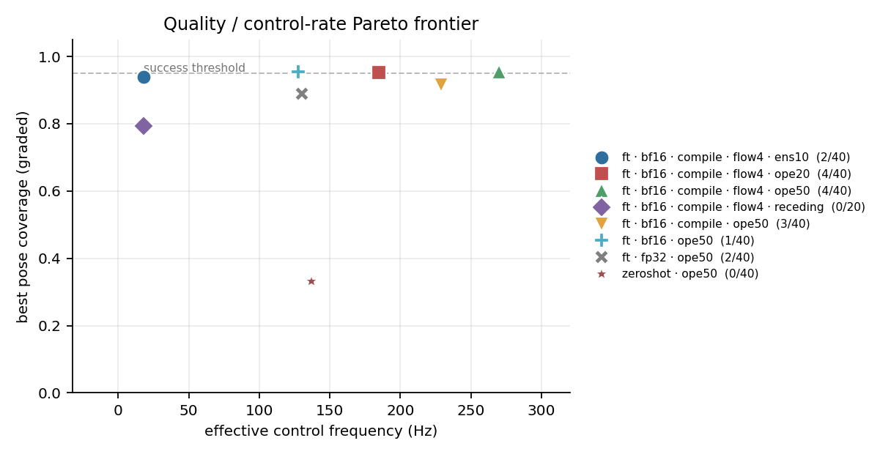
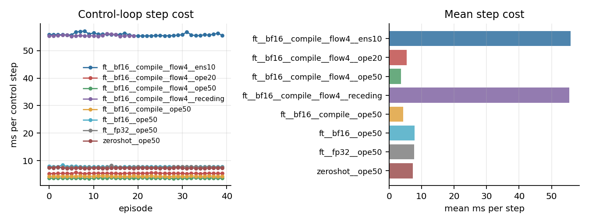

# Evaluation report

| # | config | mode (exec/chunk) | success | 95% Wilson CI | control Hz | p50 lat (ms) | p95 lat (ms) | steps/inference | mean steps | best coverage |
|---|--------|-------------------|---------|---------------|------------|--------------|--------------|-----------------|------------|-----------------|
| 1 | ft__bf16__compile__flow4__ens10 | temporal_ens (10/50) | **5%** | 1%-17% | 17.9 | 52.4 | 54.27 | 1.0 | 296 | 0.94 |
| 2 | ft__bf16__compile__flow4__ope20 | open_loop (20/50) | **10%** | 4%-23% | 184.7 | 54.97 | 56.09 | 19.917 | 292 | 0.95 |
| 3 | ft__bf16__compile__flow4__ope50 | open_loop (50/50) | **10%** | 4%-23% | 269.9 | 53.5 | 54.3 | 49.627 | 289 | 0.95 |
| 4 | ft__bf16__compile__flow4__receding | receding (1/50) | **0%** | 0%-16% | 18.0 | 52.24 | 53.36 | 1.0 | 300 | 0.79 |
| 5 | ft__bf16__compile__ope50 | open_loop (50/50) | **8%** | 3%-20% | 228.7 | 85.88 | 89.68 | 49.828 | 298 | 0.91 |
| 6 | ft__bf16__ope50 | open_loop (50/50) | **2%** | 0%-13% | 127.4 | 260.55 | 265.3 | 49.904 | 299 | 0.95 |
| 7 | ft__fp32__ope50 | open_loop (50/50) | **5%** | 1%-17% | 130.4 | 249.88 | 264.64 | 49.845 | 297 | 0.89 |
| 8 | zeroshot__ope50 | open_loop (50/50) | **0%** | 0%-9% | 136.7 | 237.3 | 250.03 | 50.0 | 300 | 0.33 |

`control Hz` is the effective closed-loop rate (1 / mean environment step time, including reused actions); `p50/p95 lat` are per-inference latencies measured with CUDA synchronisation; `steps/inference` is how many control steps one forward pass buys. `best coverage` is the mean best pose overlap reached during an episode (success needs 0.95) -- a graded signal that keeps moving when binary success is still stuck at zero.

## Figures

### success

### coverage

### pareto

### latency

## Failure taxonomy

| config | episodes | success | near miss | touched, missed | never contacted | unknown |
|---|---:|---:|---:|---:|---:|---:|
| ft__bf16__compile__flow4__ens10 | 40 | 2 (5%) | 33 | 4 | 1 | 0 |
| ft__bf16__compile__flow4__ope20 | 40 | 4 (10%) | 36 | 0 | 0 | 0 |
| ft__bf16__compile__flow4__ope50 | 40 | 4 (10%) | 36 | 0 | 0 | 0 |
| ft__bf16__compile__flow4__receding | 20 | 0 (0%) | 9 | 11 | 0 | 0 |
| ft__bf16__compile__ope50 | 40 | 3 (8%) | 35 | 2 | 0 | 0 |
| ft__bf16__ope50 | 40 | 1 (2%) | 39 | 0 | 0 | 0 |
| ft__fp32__ope50 | 40 | 2 (5%) | 32 | 6 | 0 | 0 |
| zeroshot__ope50 | 40 | 0 (0%) | 0 | 11 | 29 | 0 |

*Near miss* = the block was moved and the best pose overlap reached 0.85 of the 0.95 needed for success (position roughly right, pose not). *Never contacted* = the end-effector never touched the block, which points at reaching/perception rather than manipulation.

## Raw

Per-episode records and full configuration are in the sibling JSON files.
