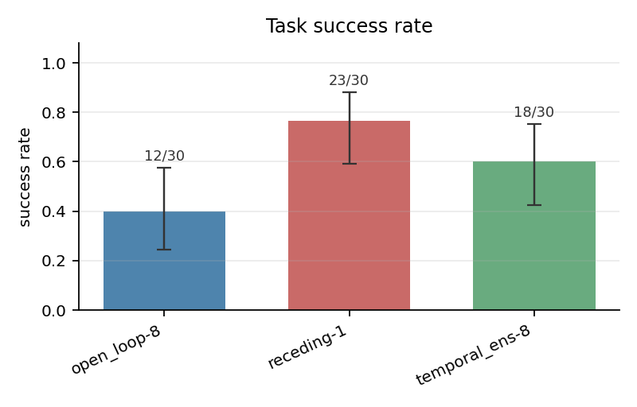
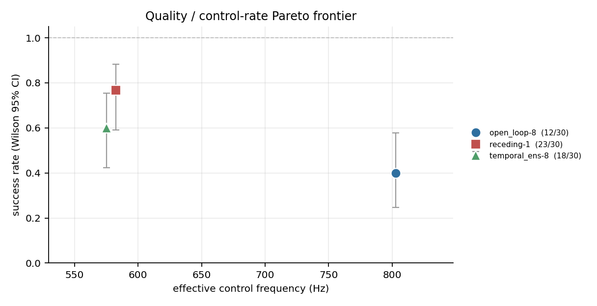
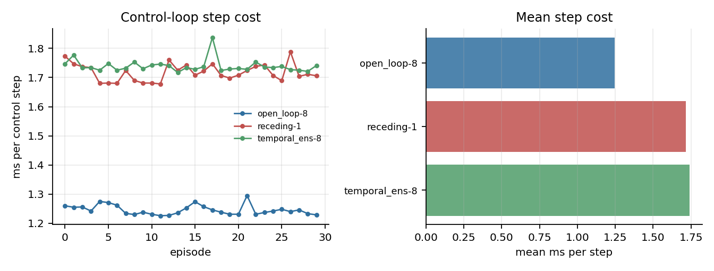

# Evaluation report

| # | config | mode (exec/chunk) | success | 95% Wilson CI | control Hz | p50 lat (ms) | p95 lat (ms) | steps/inference | mean steps |
|---|--------|-------------------|---------|---------------|------------|--------------|--------------|-----------------|------------|
| 1 | open_loop-8 | open_loop (8/8) | **40%** | 25%-58% | 802.7 | 0.48 | 0.51 | 7.654 | 35 |
| 2 | receding-1 | receding (1/8) | **77%** | 59%-88% | 582.4 | 0.47 | 0.49 | 1.0 | 24 |
| 3 | temporal_ens-8 | temporal_ens (8/8) | **60%** | 42%-75% | 575.0 | 0.47 | 0.49 | 1.0 | 29 |

`control Hz` is the effective closed-loop rate (1 / mean environment step time, including reused actions); `p50/p95 lat` are per-inference latencies measured with CUDA synchronisation; `steps/inference` is how many control steps one forward pass buys. `best coverage` is the mean best pose overlap reached during an episode (success needs 0.95) -- a graded signal that keeps moving when binary success is still stuck at zero.

## Figures

### success

### pareto

### latency

## Raw

Per-episode records and full configuration are in the sibling JSON files.
